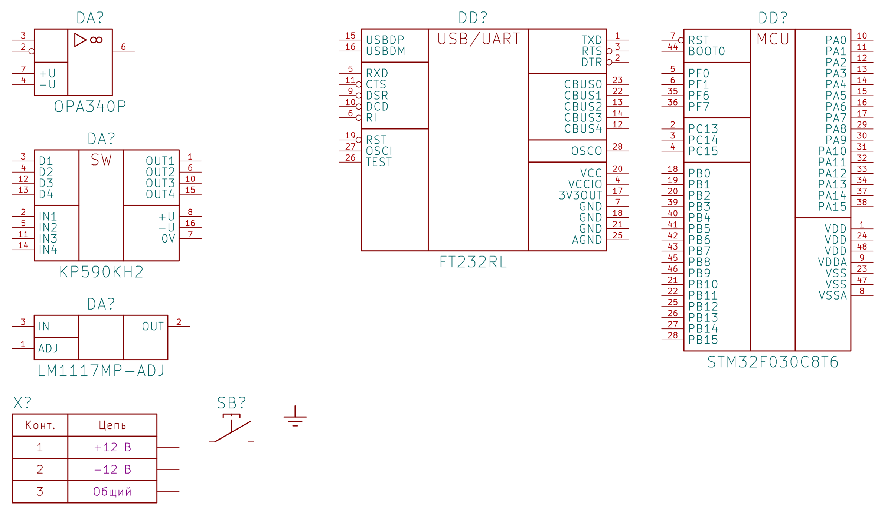
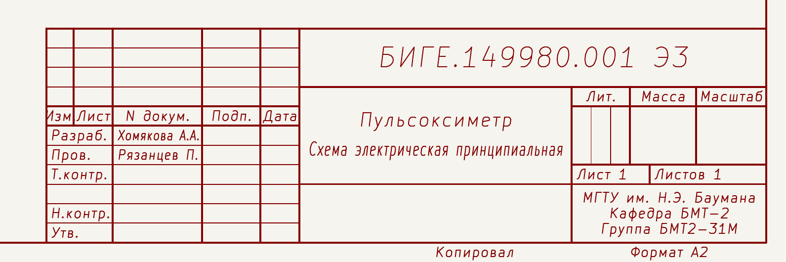

# kicad-gost-lib — УГО и рамка по ЕСКД для KiCad 9/10

Библиотека подключается к проектам как **git-сабмодуль** в папку `lib/kicad-gost-lib`,
пути в проектах — только относительные (`${KIPRJMOD}`).

```
kicad-gost-lib/
├── symbols/GOST_UGO.kicad_sym          УГО компонентов (12 шт.)
├── drawing_sheets/GOST_form1.kicad_wks рамка листа + основная надпись, ГОСТ 2.104 форма 1
├── tools/gen_gost_lib.py               генератор УГО (символы описаны кодом)
├── tools/gen_wks.py                    генератор рамки
└── docs/                               изображения
```

## Состав УГО

| Символ | Поз. обозн. | ГОСТ |
|---|---|---|
| `OPA340P` — ОУ, DIP-8 | DA | 2.759 (основное поле «▷∞»), 2.743 |
| `KR590KN2` — 4-канальный аналоговый ключ | DA | 2.743 (функция «SW») |
| `LM1117MP-ADJ` — LDO-стабилизатор | DA | 2.743 |
| `STM32F030C8Tx` — микроконтроллер, LQFP-48 | DD | 2.743 (функция «MCU») |
| `FT232RL` — преобразователь USB–UART | DD | 2.743 (функция «USB/UART») |
| `Conn_1x02` … `Conn_1x06` — соединитель | X (XP/XS) | 2.755, таблица «Конт. / Цепь» |
| `SW_Push_NO` — кнопка, замыкающий контакт | SB | 2.755, 2.721 |
| `GND` — общий провод | #PWR | 2.721 |



Особенности: ИМС с основным и дополнительными полями, выводы сгруппированы по функциям,
инверсные выводы — указателем инверсии (кружком), питание отдельной группой, корпус без заливки,
шаг выводов 2,54 мм. В символах заполнены поля `Footprint`, `Datasheet`, `Manufacturer`,
`Manufacturer_Part_Number`. У соединителя наименования цепей — поля экземпляра `Цепь1…ЦепьN`.

## Рамка `GOST_form1.kicad_wks`

Рамка (поле подшивки 20 мм, остальные 5 мм), основная надпись по форме 1 (185 × 55 мм),
дополнительные графы 19–26, «Копировал», «Формат». Графы заполняются в
*Файл → Параметры страницы* проекта:

| Поле KiCad | Графа ГОСТ 2.104 |
|---|---|
| Comment 1 | 2 и 26 — обозначение документа |
| Title / Comment 2 | 1 — наименование изделия / документа |
| Comment 3 … 7 | Разраб., Пров., Т.контр., Н.контр., Утв. |
| Company, Comment 8, 9 | 9 — организация (3 строки) |
| `${#}`, `${##}`, `${PAPER}` | лист, листов, формат |



## Подключение к проекту

```bash
git submodule add ../kicad-gost-lib.git lib/kicad-gost-lib
```

`sym-lib-table` проекта:

```
(lib (name "GOST_UGO")(type "KiCad")(uri "${KIPRJMOD}/lib/kicad-gost-lib/symbols/GOST_UGO.kicad_sym")(options "")(descr "УГО по ЕСКД"))
```

Рамка: *Файл → Параметры страницы → Файл рамки* —
`${KIPRJMOD}/lib/kicad-gost-lib/drawing_sheets/GOST_form1.kicad_wks`.

## Перегенерация

```bash
python3 tools/gen_gost_lib.py          # symbols/GOST_UGO.kicad_sym (шаг 2,54 мм)
python3 tools/gen_gost_lib.py --pitch 5.08 -o GOST_UGO_5mm.kicad_sym   # шаг 5,08 мм
python3 tools/gen_wks.py               # drawing_sheets/GOST_form1.kicad_wks
```
